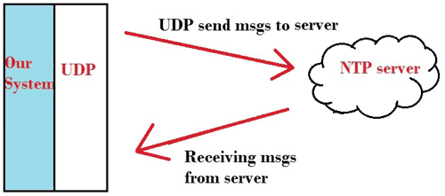
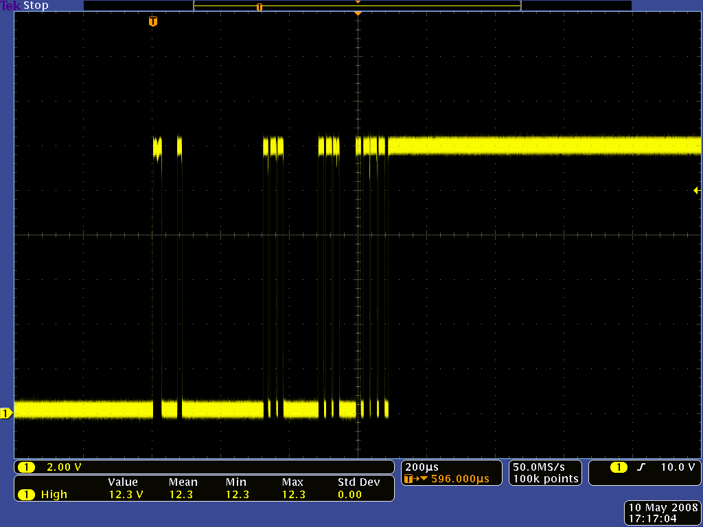
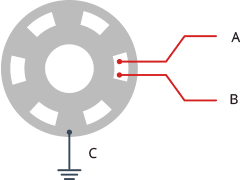
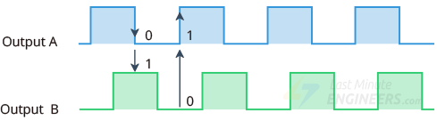
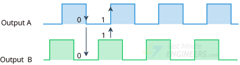

# How each piece works

> **Firmware:** this page describes the Arduino sketch. The default
> ESPHome build uses the same hardware and the same rules (clock,
> DHT11 interval and averaging, button, encoder, pot, PIR), but gets
> outdoor weather from Home Assistant instead of Open-Meteo and uses
> `use_encoder` / `use_pir` instead of the `USE_*` defines. Its
> differences are listed in [esphome.md](esphome.md).

## The clock — NTP over WiFi

The SuperMini has no battery-backed RTC, so on boot it asks an
internet time server (NTP, `pool.ntp.org`) for the current UTC time,
then converts it to local time with the POSIX time-zone string set in
the sketch (for example `EST5EDT,M3.2.0,M11.1.0` for Eastern Time).
That string carries both the standard/daylight offsets and the
daylight-saving switch dates, so no separate DST handling is needed.



How NTP works, conceptually: the client asks a time server over UDP
(port 123) and the server answers with the time of day. Diagram:
CircuitDigest — note this is a concept diagram, not wiring for this
build (CircuitDigest's own clock uses SPI; this build uses I2C).

After the first sync, the chip's internal timer keeps time and the
sketch reads it once a second with a non-blocking `time()` check:
until NTP has answered (the epoch is below `MIN_VALID_EPOCH`), the
clock shows `--:--`. SNTP re-syncs
periodically in the background. Lose the internet connection and the
clock keeps ticking; lose power and it re-syncs on the next boot.

WiFi is not waited on forever: after a 30 s timeout the sketch
continues anyway and prints "WiFi: connection failed (30 s timeout)"
to Serial (or "WiFi: connected" on success). A WiFi failure therefore
shows as the clock page with `--:--` — WiFi connected but NTP not
yet synced shows the same `--:--` — plus "WiFi DOWN" on the Summary
page, not a blank screen. NTP and the weather fetch keep working in
the background, so both recover on their own when WiFi comes up.

## Indoor readings — the DHT11, and its limits

The DHT11 is a one-wire digital sensor. Figures below are from the
Aosong datasheet; third-party summaries disagree on humidity range
(80 %, 90 %, 95 %), current and supply minimum, and the datasheet is
used here.

| Parameter | Value |
| --------- | ----- |
| Operating voltage | 3–5.5 V (powered from 3V3 here; never pull the data line up to 5 V, which would put 5 V on a C3 GPIO) |
| Temperature range | 0–50 °C, ±2 °C accuracy |
| Humidity range | 20–90 % RH, ±5 % RH accuracy |
| Sampling period | 1 s minimum |
| Current | 0.5 mA typical, 2.5 mA maximum while measuring; 100 µA standby (use 2.5 mA for the power budget) |
| Pull-up (bare 4-pin sensor) | 5 kΩ recommended for cables under 20 m (4.7 kΩ used here); optional 100 nF between VDD and GND. Modules include their own. |

That accuracy is fine for "is the room hot and dry", which is all a
desk gadget needs — but it is not a precision instrument. A reading of
20 °C means the real temperature is plausibly anywhere from 18 °C to
22 °C. For tighter accuracy or outdoor use, a DHT22 is a drop-in
replacement (same wiring, same library, change `DHT11` to `DHT22` in
the sketch) with different specs: range −40 °C to +80 °C, ±0.5 °C,
0–100 % RH, and a sampling period of at least 2 seconds — the
sketch's 2.5-second interval satisfies that.

Two rules, both baked into the code:

- **Read it no faster than every 2.5 seconds here.** The datasheet
  allows 1 Hz, but the Adafruit library caches reads for 2000 ms, so
  polling faster returns stale values. The sketch reads on a 2.5-second
  `millis()` timer.
- **Always check for failure.** A failed read returns NaN ("not a
  number"). The sketch tests `isnan()` and keeps the last good values:
  the Indoor page shows "No reading" and the Summary page "In --" until
  the first good read (after a reboot there is no last value), instead
  of printing `nan`.

The display shows the mean of the last 5 good reads (about 12.5 s),
not the latest single read. The DHT11 reports whole degrees and whole
percent, so a room sitting between two values would otherwise make
the display flip back and forth. Averaging steadies the number; it
does not make the sensor more accurate than ±2 °C / ±5 % RH.

And a rule for the whole program: **no long `delay()` calls in the
main loop.** A single-screen station can sleep for 10 minutes between
weather fetches, but here that would freeze the button or encoder and the clock.
Every recurring job in this sketch (DHT, weather, redraw, pot) runs off
its own `millis()` timer, so everything stays responsive at once.
One exception to know about: the weather fetch itself is a blocking
HTTPS request with a 4 s connect, a 4 s TLS handshake and a 4 s read
timeout (the core's default handshake timeout is 120 s). A failing fetch
usually blocks for a few seconds and at worst about 12 s plus DNS lookup
time, and button presses and encoder turns during that window are missed. That is an accepted trade-off, not a bug to chase.

## Outdoor weather — Open-Meteo, no key

The pattern, taken from the MakerGuides weather station: WiFi connects,
HTTPClient downloads a JSON document, ArduinoJson picks the fields out
of it, and the OLED displays them. The first fetch happens as soon as
WiFi is connected; after a success the sketch fetches
every 10 minutes, and after a failure it retries every 60 seconds. The
Outdoor page shows "Updated N min ago". This build uses Open-Meteo
instead of OpenWeatherMap: free for non-commercial use (under 10,000
calls a day per [Open-Meteo's terms](https://open-meteo.com/en/terms) —
this gadget makes 144 requests a day when every fetch succeeds;
failures retry every 60 s), no signup, no key in the URL.

The sketch uses `WiFiClientSecure` with `setInsecure()`: the traffic is
TLS-encrypted, but the server certificate is not verified, so a
man-in-the-middle could in principle feed it false weather. For a
read-only weather display that is an accepted trade-off; the core's
built-in CA bundle is an optional hardening step (it needs a larger
partition scheme).

The request is built from the sketch's location settings, with
coordinates sent to 4 decimal places (about 11 m precision):

```
https://api.open-meteo.com/v1/forecast?latitude=<LAT>&longitude=<LON>&current=temperature_2m,relative_humidity_2m,weather_code,wind_speed_10m&timezone=<IANA_TIMEZONE>
```

The time-zone name is appended raw, not URL-encoded: a slash in
`America/Toronto` is accepted unencoded in a query string by
Open-Meteo. The sketch sends no unit parameters, so the wind label
"km/h" on the display is correct only under Open-Meteo's defaults
(Celsius, km/h) — if a unit parameter is ever added, the display
label must change with it.

From the reply, the sketch reads
`doc["current"]["temperature_2m"]`, `["relative_humidity_2m"]`,
`["weather_code"]`, and `["wind_speed_10m"]`. Paste the URL into a
browser first and look at the raw JSON — seeing the structure once
makes the parsing code obvious.

The one quirk: Open-Meteo does not send a text description, it sends
a numeric weather code. Open-Meteo uses a subset of WMO codes (not the
full 00–99 present-weather set), and the sketch translates each of the
29 codes to its own label (Open-Meteo's table; 96 and 99 use shorter
labels than Open-Meteo's combined "Thunderstorm with slight and heavy hail";
long labels wrap onto a second line on the Outdoor page, and the Summary
page shows outdoor temperature and humidity only):

| Code | Meaning |
| ---- | ------- |
| 0 | Clear sky |
| 1 | Mainly clear |
| 2 | Partly cloudy |
| 3 | Overcast |
| 45 | Fog |
| 48 | Depositing rime fog |
| 51 | Light drizzle |
| 53 | Moderate drizzle |
| 55 | Dense drizzle |
| 56 | Light freezing drizzle |
| 57 | Dense freezing drizzle |
| 61 | Slight rain |
| 63 | Moderate rain |
| 65 | Heavy rain |
| 66 | Light freezing rain |
| 67 | Heavy freezing rain |
| 71 | Slight snowfall |
| 73 | Moderate snowfall |
| 75 | Heavy snowfall |
| 77 | Snow grains |
| 80 | Slight rain showers |
| 81 | Moderate rain showers |
| 82 | Violent rain showers |
| 85 | Slight snow showers |
| 86 | Heavy snow showers |
| 95 | Thunderstorm |
| 96 | Thunderstorm with slight hail |
| 97 | Heavy thunderstorm |
| 99 | Thunderstorm with heavy hail |

Codes 96 and 99 are only reported by models with an explicit hail
forecast; other models report 95 and 97 instead. Any code outside this
table (including 98 in the full WMO set, which Open-Meteo does not
return) shows as `-` on the screen, which is the safe fallback if
Open-Meteo ever adds a code.

## Navigation — the push button and the optional encoder

The default navigation input is one push button between GPIO 10 and GND, read with INPUT_PULLUP (no resistor): the line reads HIGH when released and LOW when pressed. Each press steps to the next page: Clock → Indoor → Outdoor → Summary → Clock. A press counts only if the line was HIGH for at least 30 ms, so contact bounce is ignored, and holding the button does not repeat the step. With `USE_PIR` 1, a press also wakes the display. Wiring: [wiring.md](wiring.md#push-button-wiring-4-pin).



Contact bounce: when a mechanical switch closes, the line chatters
between low and high for under a millisecond before it settles
(200 µs per division; a larger switch on a 12 V signal). The 30 ms
rule ignores this chatter. Capture: Pololu.

The optional rotary encoder (`USE_ENCODER` 1) replaces the button on GPIO 10. It works as follows.

An incremental rotary encoder outputs two square waves, CLK and DT,
90° out of phase. Both look identical on their own; the trick is that
which one leads tells you the direction. Turn clockwise and CLK changes
first; turn counter-clockwise and DT changes first. That phase
relationship is the entire mechanism — inside, a slotted disc and
contacts generate the two offset signals as the knob turns.



Inside the encoder: the rotating disc and contacts that produce the two
phase-shifted signals. On a bare encoder the terminals are A (CLK),
B (DT) and the common C, which goes to GND. Diagram:
LastMinuteEngineers, ESP32 Rotary Encoder Tutorial.


The same mechanism in motion: as the disc turns, CLK and DT make
contact in sequence, one always leading the other. Animation:
LastMinuteEngineers.



Clockwise: CLK leads DT. Diagram: LastMinuteEngineers.



Counter-clockwise: DT leads CLK — the phase relationship is reversed,
and that reversal is how the code knows which way the knob turned.
Diagram: LastMinuteEngineers.

Two ways to read it, both covered by the LastMinuteEngineers tutorial:

- **Polling (used in this sketch):** watch CLK in the main loop; when
  it changes, read DT. If DT differs from CLK's new state, the knob
  turned one way; if it matches, the other. Simple, and fast enough
  here because the loop never blocks for long (see the weather-fetch
  caveat above). The sketch acts on the CLK falling edge with a 3 ms
  bounce guard.
- **Interrupt + decode table:** attach interrupts to both pins and
  feed the 4-bit (old CLK/DT, new CLK/DT) state through a 16-entry
  quadrature table. More robust at high spin speeds and on busier
  programs — the upgrade path if the knob ever feels like it misses
  steps.

Three practical details: the pins are configured INPUT_PULLUP (the
signals are mechanical switches to GND: HIGH open, LOW closed);
the encoder's push switch is edge-triggered (it acts only on the HIGH→LOW
transition, and a press counts only if the line was released for at
least 30 ms, so contact bounce and holding it down do not re-trigger
— a press jumps to Summary, a second press returns to
Clock, it never steps through pages); and if the knob counts
backwards, just swap the CLK and DT wires (or swap the two pin
numbers in code). Both are equally correct fixes.

## Dimming — there is no backlight to dim

An OLED pixel makes its own light, so there is no backlight knob.
Brightness is set by the SSD1306's contrast register: send
`SSD1306_SETCONTRAST` followed by a value from 0–255.
The sketch reads the pot on GPIO 1 every 50 ms with
`analogReadMilliVolts()`, clamps the result to 0–2500 mV, and maps it
onto contrast 8–255 (displayed values roughly 8–12 at one end to
251–255 at the other, because of a hysteresis of 4). The floor of 8
keeps the screen from going fully invisible mid-adjustment.


A pot is a voltage divider: R1 and R2 are the parts of the track on
either side of the wiper, and Vout is the wiper voltage that the ADC
reads (here Vin is 3V3). Diagram: Wikimedia Commons, public domain.

At the default 11 dB attenuation the C3 ADC's effective range is
0–2500 mV (datasheet Table 5-6), so on a pot wired across 3V3 the top
~24% of travel is full brightness. That is expected, not a fault.
Optionally, a 3.3 kΩ resistor in series between 3V3 and the pot's end 1
limits the wiper maximum to about 2.48 V (with a 10 kΩ pot) so the
full travel is usable, and a 100 nF capacitor from the wiper to GND
steadies the reading.

The pot must be on an ADC1 pin (GPIO 0–4 on the C3). GPIO 5 is ADC2,
and ESP-IDF states that ADC2 oneshot mode is no longer supported due to
hardware limitations ("the results are not stable"). That is why the
pot is on GPIO 1, even though GPIO 5 is also used in this build as
the I2C clock line (digital use of GPIO 5 is fine; analog use is
the problem).

Two warnings: at very low contrast the display can look patchy rather
than elegantly dim — that is the panel, not the wiring — and for true
"off", use the display on/off commands instead, which is exactly what
the optional PIR sleep does.

## Optional PIR sleep


The HC-SR501's delay ("Off Time") pot and H/L jumper set how long OUT
stays HIGH after motion. Diagram: Components101.

The panel blanks 60 s after PIR OUT goes LOW — i.e. the module's
delay-pot time plus 60 s after the last motion. Pressing the button, or turning or pressing the encoder, also wakes it.

---

[← Previous: Libraries & setup](libraries-and-setup.md) · [Contents](../README.md) · [Next: Build order →](build-order.md)
