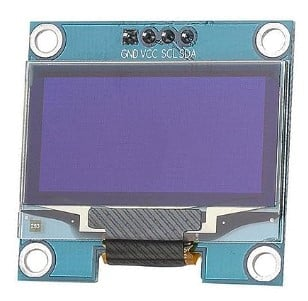

# Parts

Everything below is already in the inventory — the first lines are the
ESP32 starter kit, the encoder is #15 in the 45-in-1 sensor kit.

| Qty | Part | From | Notes |
| --- | ---- | ---- | ----- |
| 1 | ESP32 development board | Starter kit | Any classic ESP32 dev board. Note its printed SDA/SCL pins before wiring — see [wiring.md](wiring.md). |
| 1 | 0.96″ OLED, SSD1306, 128×64, I2C | Starter kit | 4 pins: GND / VCC / SCL / SDA. I2C address 0x3C (a few boards are 0x3D — see [troubleshooting.md](troubleshooting.md)). |
| 1 | DHT11 temperature + humidity module | Starter kit | The 3-pin module version (built-in pull-up), not the bare 4-pin sensor. |
| 1 | Rotary encoder module (CLK / DT / SW) | 45-in-1 kit, #15 | Incremental encoder with push button. The navigation control. |
| 1 | Potentiometer, 10K analog | Starter kit | Brightness only. A linear (B) taper is fine here. |
| 1 | Breadboard, 830 tie-points | Starter kit | Big enough for everything with room to spare. |
| ~15 | Jumper wires (M-M) | Bench stock | Count the wiring table in [wiring.md](wiring.md). |
| 1 | Micro USB cable | Starter kit | Must be a data cable, not charge-only — it carries power and the firmware upload. |
| 1 | HC-SR501 PIR motion sensor (optional) | Starter kit | Only for the wake/sleep extra. Skip it on the first build. |

An ESP32 board of the same family as the one in the MakerGuides
weather station — yours may look slightly different, the pins that
matter are 3V3, GND, and your board's SDA/SCL. Photo: MakerGuides.

The breadboard this build goes on — everything in this guide is
breadboarded, nothing soldered. Photo: MakerGuides.

Jumper wires for the ~15 connections in [wiring.md](wiring.md).
Photo: MakerGuides.

The display: a 0.96″ SSD1306 OLED, 128×64, I2C. Note the pin order
printed on the board — GND, VCC, SCL, SDA — which is the order you'll
wire in [wiring.md](wiring.md). Photo: MakerGuides, Simple ESP32 Internet
Weather Station.
