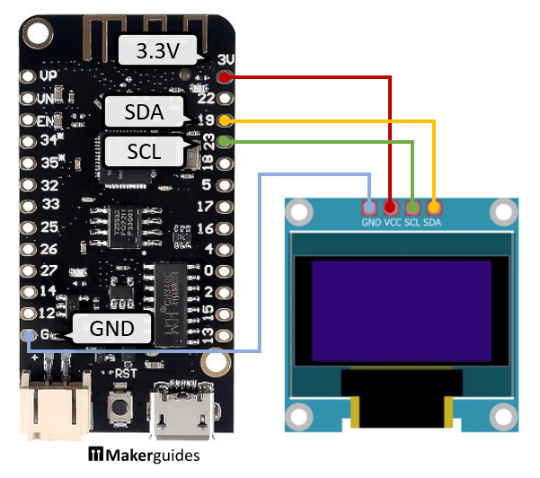
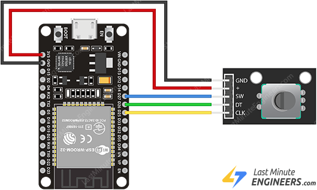

# Wiring — ESP32-C3 SuperMini

This build is for the **ESP32-C3 SuperMini**, not a classic ESP32
development board. Pin numbers from classic ESP32 guides (SDA 21 /
SCL 22, encoder 25 / 26 / 27, pot on GPIO 34) do not apply to this
board — do not use them. The SuperMini breaks out only 13 GPIOs:
0, 1, 2, 3, 4, 5, 6, 7, 8, 9, 10, 20, 21 (20/21 are the UART pins,
left unused here). Pins 22, 25, 26, 27 and 34 do not exist on this board.

Everything except the optional PIR runs at 3.3 V from the SuperMini's
3V3 pin — the HC-SR501's VCC goes to the 5V pin (its OUT pin is still
3.3 V logic, safe for GPIO 0). Wire the circuit unpowered,
double-check every connection against the table, then plug in USB-C.

> **Power-pin safety.** 5V, GND and 3V3 sit next to each other on the
> header. The 5V pin is USB VBUS passed straight through (many boards
> have no protection diode), and the 3V3 pin is also an input to the
> 3.3 V rail. Never connect 5V to 3V3 — the ESP32-C3 power pins are
> rated 3.6 V maximum. Never feed the 5V pin from another supply while
> USB is plugged in. Only the PIR uses 5V; everything else goes on
> 3V3. Two module-specific rules follow from that: the encoder
> module's "+" pin must be on 3V3 (its pull-up resistors go to "+",
> and CLK/DT/SW then swing to that voltage), and the OLED's VCC must
> be on 3V3 (the module's I2C pull-ups go to VCC).

| Module | Module pin | Connects to | Why / notes |
| ------ | ---------- | ----------- | ----------- |
| OLED (SSD1306) | VCC | SuperMini 3V3 | I2C bus. Only two signal wires for the whole display. Pin order varies by module (the pictured module is GND, VCC, SCL, SDA) — read the silkscreen. |
| | GND | SuperMini GND | |
| | SDA | SuperMini GPIO 4 | See the I2C warning below — deliberately **not** GPIO 8. |
| | SCL | SuperMini GPIO 5 | Deliberately **not** GPIO 9. |
| DHT11 | VCC | SuperMini 3V3 | The module version includes its own pull-up resistor. 3-pin modules differ in pin order — read the silkscreen; reversed power can destroy the sensor. A bare 4-pin DHT11 needs a 4.7 kΩ resistor between DATA and VCC (see [parts.md](parts.md)). |
| | GND | SuperMini GND | |
| | DATA (OUT) | SuperMini GPIO 3 | Digital input; GPIO 3 is also ADC1_CH3, but here it's used digitally. |
| Rotary encoder | + / VCC | SuperMini 3V3 | All three signal pins use INPUT_PULLUP in code. A module with no "+" pin is a bare encoder — see the bare-encoder wiring below. |
| | GND | SuperMini GND | |
| | CLK | SuperMini GPIO 6 | |
| | DT | SuperMini GPIO 7 | |
| | SW | SuperMini GPIO 10 | Safe, non-strapping GPIO. |
| Potentiometer (10K) | End 1 | SuperMini 3V3 | Must be an ADC1 pin: GPIO 1 is ADC1_CH1. Do **not** use GPIO 5 for the pot — GPIO 5 is ADC2, and ADC2 readings are unreliable while WiFi is on. |
| | Wiper (middle) | SuperMini GPIO 1 | |
| | End 2 | SuperMini GND | |
| PIR (optional) | VCC | SuperMini 5V | HC-SR501 requires 5 V input; its OUT pin is 3.3 V logic, safe for the SuperMini. Only add after the base build works. |
| | GND | SuperMini GND | |
| | OUT | SuperMini GPIO 0 | GPIO 0 and 1 are the 32 kHz crystal pins (XTAL_32K_P/N) on the chip; the SuperMini has no 32 kHz crystal, so both are free. |

## ⚠ The C3 SuperMini I2C trap — read this before wiring the OLED

On the ESP32-C3, I2C is **not** fixed to specific pins at chip level —
it runs through the GPIO matrix, so the sketch must say which pins to
use, and it does: `Wire.begin(4, 5)`.

Do **not** use the pins many online guides call the "default" I2C
pins, GPIO 8 / GPIO 9:

- **GPIO 8** is a strapping pin, and on most SuperMini boards it also
  drives the onboard LED (WS2812 on some variants). Using it for SDA
  fights the LED and can disturb boot.
- **GPIO 9** is a strapping pin and the BOOT button: pulling it low at
  reset puts the chip in download mode instead of running your program.
  An I2C device pulling SCL low at the wrong moment can do exactly that.

The third strapping pin, **GPIO 2**, is likewise left unused in this
build. GPIO 20 / 21 (the UART0 RX/TX pins) are left free; Serial runs
over the native USB port.

If your OLED stays black, check in this order: SDA/SCL are on GPIO 4/5
(not 8/9, and not classic-ESP32 pins such as 21/22), the sketch's `Wire.begin(4, 5)` matches, the I2C
address is 0x3C (a few modules are 0x3D), and VCC is on 3V3, not 5V.
SuperMini board variants differ slightly (standard boards have a
simple blue LED on GPIO 8; "Plus" variants have a WS2812 RGB LED on
GPIO 8), and printed labels can vary by manufacturer — always go by
the GPIO number, and compare the board in hand with its printed labels
before wiring. Either way, GPIO 8 stays unused in this build.

Wrong board — wiring pattern only: this MakerGuides diagram is for an
ESP32-Lite (SDA 19 / SCL 23). Four wires: GND, 3.3 V, SCL, SDA. On the SuperMini, use
SDA GPIO 4 / SCL GPIO 5. Diagram: MakerGuides.

Wrong board — wiring pattern only: the LastMinuteEngineers reference
wiring uses different GPIOs than this guide; keep the pattern (CLK, DT, SW each
to a GPIO, module powered from the board) and use this guide's pins:
CLK 6, DT 7, SW 10. Diagram: LastMinuteEngineers.

The encoder module's pins, labelled: GND, + (power), SW (push-button),
DT and CLK (the two quadrature signals). If your module's pin order
differs, go by the labels, not the positions. Diagram:
LastMinuteEngineers.

## Bare encoder (no module board)

A bare encoder has three pins on one side (A, C, B) and two switch
terminals on the other. Wire C (common) to GND, A to GPIO 6 (CLK), B
to GPIO 7 (DT), and the two switch terminals to GPIO 10 and GND.
Nothing is powered. Optionally add a 10 nF capacitor from each of CLK
and DT to GND to reduce bounce. If it counts backwards, swap A and B.

## Swapping the encoder for something else

A tactile button between GPIO 10 and GND (with INPUT_PULLUP) is an
alternative to the encoder's push button — but a press jumps to
Summary, and a second press returns to Clock; it does not step
through pages. Do NOT wire a button on GPIO 10 at the same time as
the encoder's SW pin.

A TTP223 touch module wires VCC→3V3, GND→GND, OUT→GPIO 10. It does
not behave like that button out of the box: a default TTP223 (both
jumpers unsoldered) is momentary active-HIGH (OUT HIGH on touch), exactly
backwards for the sketch's active-LOW button logic, and there is no
TTP223 code path in the sketch. Solder jumper A for active-low
output, or invert the logic for that input — not both. Power it
from 3V3 only (its output is VCC-driven, so 5 V power would drive
OUT to about 4 V), and do not wire it at the same time as the
encoder's SW pin: a button press would short TTP223 OUT to GND.

Two more module traps, before you power anything: bare SSD1306
panels and bare DHT11 sensors have no pull-up resistors — the wiring
table as written assumes module versions, which include them. And
always read the OLED module's silkscreen before powering it: pin
order varies, and the bare SSD1306 chip is not 5 V-tolerant.

Note: the classic ESP32's bare capacitive-touch trick does **not**
work here — the ESP32-C3 has no capacitive touch peripheral, unlike
the classic ESP32. On this board, touch means the TTP223 module, not a
bare wire or foil pad.

---

[← Previous: Parts](parts.md) · [Contents](../README.md) · [Next: Libraries & setup →](libraries-and-setup.md)
